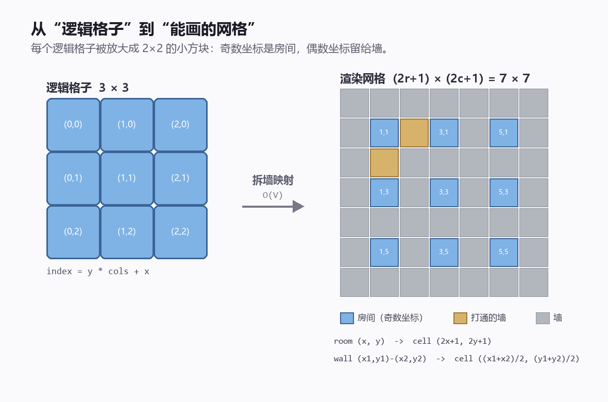
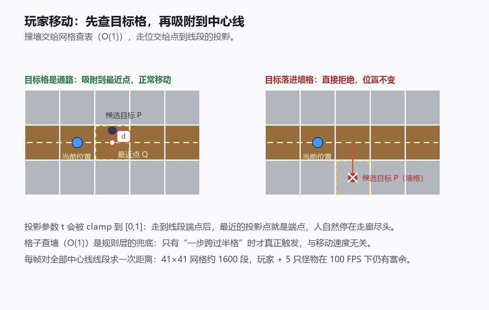

> 一个 OpenGL 课设里的算法笔记：迷宫生成、拆墙映射、中心线移动，以及「提示路径真的最短吗」

## 写在前面

课程结课作业是一个用 OpenGL / GLUT 写的 2D 迷宫游戏：石头墙 + 木头走廊，随机生成 20×20 的迷宫，
玩家用 WASD 控制，5 只怪物随机巡逻，走到右下角的红色出口就算通关。

这篇文章不聊怎么配 OpenGL 环境，只聊里面真正有意思的算法：

1. 迷宫怎么「长」出来 —— 随机化 Prim 最小生成树；
2. 逻辑格子怎么变成能画的网格 —— 拆墙映射；
3. 玩家为什么能贴着走廊顺滑地走 —— 点到线段距离 + 位置吸附；
4. 提示路径是不是最短 —— DFS 与 BFS 的一次对照实验；
5. 时间步进与怪物巡逻这两个小机制。

工程规模不大：20×20 个房间、41×41 个渲染格、约 760 条边、1600 段中心线。所有算法都跑得飞快。

---

## 一、先把「迷宫」翻译成图论

整个项目的地基是一个很朴素的观察：**完美迷宫就是一棵生成树**。

- 20×20 个房间 → 图的 400 个顶点；
- 相邻房间之间的一堵墙 → 一条边；
- 「打通一堵墙」= 「选中一条边」；
- 要求所有房间连通、且任意两间房之间只有一条路 → 正好是生成树。

于是「生成迷宫」就等价于「在网格图上随机求一棵生成树」。DFS、Kruskal、Prim 都能做，区别只是长出来的「气质」不同：

| 算法         | 生成树的形状   | 玩起来的感受             |
| ------------ | -------------- | ------------------------ |
| 随机 DFS     | 长走廊、少分叉 | 一眼望不到头，容易迷路   |
| 随机 Prim    | 短走廊、分叉多 | 岔路多，处处像「刚来过」 |
| 随机 Kruskal | 更均匀、更碎   | 房间感强                 |

这个项目选的是随机化 Prim。

## 二、邻接表：把「墙」变成可查询的数据

要让算法工作，先得能回答两个问题：「格子 A 和 B 之间的墙还在吗？」「格子 B 还有哪些墙没被打通？」

```cpp
class AdjacencyList
{
public:
    struct Cell
    {
        int x, y;                                 // 格子坐标（列, 行）
        std::unordered_map<int, bool> neighbors;  // 邻居索引 -> 是否还有墙
    };

    AdjacencyList(int rows, int cols);
    void connect(int from, int to);              // 打通两个格子之间的墙
    std::vector<int> surround(int index) const;  // 仍然隔着墙的邻居
    bool isConnected(int from, int to) const;

private:
    int m_rows, m_cols;
    std::vector<Cell> m_cells;
};
```

为什么 `neighbors` 用 `unordered_map<int, bool>` 而不是四个固定的槽位？因为「有墙」本身是有信息量的：
网格里的格子最多 4 个方位，但只有还在的墙才算「可打通」。用 map 表达「邻居 → 墙是否还在」，
`connect()` 只是把两边各置一次 `false`：

```cpp
void AdjacencyList::connect(int from, int to)
{
    m_cells[from].neighbors[to] = false;
    m_cells[to].neighbors[from] = false;
}
```

而 `surround()` 只返回**仍然有墙**的邻居——这一步是整个算法的接口关键：Prim 的候选边，
正好就是「已经访问的格子」+「它还有墙的邻居」。

```cpp
std::vector<int> AdjacencyList::surround(int index) const
{
    std::vector<int> result;
    for (const auto& neighbor : m_cells[index].neighbors)
        if (neighbor.second) result.push_back(neighbor.first);  // 还有墙
    return result;
}
```

单次操作平均 O(1)、`surround` 最多 4 个元素，网格只有几百个格子，怎么存都不慢。

## 三、随机化 Prim：从一格开始长满整张图

伪代码只有十来行：

```text
visited = { 0 }
edges   = { (0, n) | n ∈ surround(0) }

while edges 非空:
    (u, v) = 随机取一条边并删除
    if visited[v]: continue          # 已经长在树里了
    connect(u, v); visited[v] = true # 把 v 接进树
    for n in surround(v):
        if not visited[n]: edges += (v, n)
```

**为什么不会成环？** 因为每次只把「树里的 u」和「树外的 v」连起来，已经在树里的点不会再被加边。
每一步都相当于给树挂一片新叶子，所以天然无环。

实际实现（`MazeGenerator::generateMaze`）：

```cpp
std::set<std::pair<int, int>> edges;
std::vector<bool> visited(m_rows * m_cols, false);
visited[0] = true;
for (int neighbor : maze.surround(0)) edges.emplace(0, neighbor);

while (!edges.empty())
{
    auto it = edges.begin();
    std::advance(it, engine() % edges.size());  // 随机挑一条
    int from = it->first, to = it->second;
    edges.erase(it);

    if (visited[to]) continue;

    maze.connect(from, to);
    visited[to] = true;

    for (int neighbor : maze.surround(to))
        if (!visited[neighbor]) edges.emplace(to, neighbor);
}
```

两个值得说一句的实现细节：

1. **严格来说这不是 O(E log E)。** `std::advance` 是线性遍历 `std::set`，每次挑边最坏 O(E)，
   主循环一共挑 O(E) 次，最坏 O(E²)。只不过 20×20 的网格只有约 760 条边，实测仍是毫秒级。
   想做到真正的 O(E log E)，把候选集换成 `std::vector` + 随机下标 + swap-remove 即可（O(1) 取边）。
2. **不需要手动维护候选边。** `surround()` 只返回还有墙的邻居，连过的边自动「消失」，
   而已访问判断 `visited[to]` 会兜住所有重复候选。

生成完之后，迷宫的所有信息其实都在 `AdjacencyList` 里：哪两格之间有路。问题只剩「怎么画」。

## 四、从逻辑格子到能画的网格

逻辑格子直接画也能跑，但有两个麻烦：墙没有厚度、格子之间没有「墙」这个实体。所以渲染前先做一次**拆墙映射**：



规则只有两条：

- 房间 `(x, y)` → 渲染网格 `(2x + 1, 2y + 1)`
- 两格之间打通的墙 → 渲染网格 `((x1+x2)/2, (y1+y2)/2)`

于是 `r × c` 的迷宫变成 `(2r+1) × (2c+1)` 的网格：奇数坐标是房间，偶数坐标是墙或通道。
好处很实际：

1. 每一格都是一个四边形、一张 1:1 的纹理，墙和地板的渲染代码完全一样，只是纹理不同；
2. 玩家只需要判断「目标所在格是 0 还是 1」，就完成了最朴素的通行判断（怪物用的是另一套判据，见第八节）；
3. 生成算法和渲染彻底解耦：算法只管格子图，渲染只管网格里的 0/1。

代码（`MazeGenerator::updateMazeGrid`）：

```cpp
for (const auto& cell : maze.getCells())
{
    const int cx = cell.x * 2 + 1;   // 房间
    const int cy = cell.y * 2 + 1;
    m_mazeGrid[cy][cx] = 1;

    for (const auto& neighbor : cell.neighbors)
    {
        if (neighbor.second) continue;               // 还有墙，跳过

        const int nx = (neighbor.first % m_cols) * 2 + 1;
        const int ny = (neighbor.first / m_cols) * 2 + 1;
        m_mazeGrid[(cy + ny) / 2][(cx + nx) / 2] = 1; // 中间那格 = 通道
    }
}
```

**踩过的坑**：最开始写的是 `cell.x * 2 + cellSize`，把浮点的格子尺寸混进了整数下标。
`cellSize = 1.0f` 时碰巧能跑，一改尺寸就整张图错位。教训是：坐标映射里不要出现「尺寸」，
尺寸只属于世界坐标，不属于数组下标。

代价也很清楚：格数变成 4 倍，41×41 = 1681 个四边形，每帧一次全量绘制，在 100 FPS 左右——够用，
但明显不是现代 OpenGL 的写法（要优化就该上 VBO + 批量绘制，或者干脆只画墙面）。

## 五、沿着中心线走路：把「碰撞」变成「点到线段距离」

迷宫游戏最烦的是走位：贴墙、拐角、斜着按两个键，用包围盒写起来全是边界情况。这里的做法是
**把二维走位压成一维**：先算出所有通路格子的中心点，相邻两个中心点连成线段，得到一张「中心线图」；
玩家和怪物都被约束在这张图上。



每一帧做三件事：

1. 读键盘，算出候选目标 `P = 当前位置 + 速度 × dt`；
2. 查一眼 P 落在哪一格：是墙就直接返回，这一帧不移动；
3. 是通路，就把位置吸附到 P 在中心线上的最近点 Q。

```cpp
const int targetRow = static_cast<int>(std::floor(targetY));
const int targetCol = static_cast<int>(std::floor(targetX));
if (mazeGenerator == nullptr || mazeGenerator->isWall(targetRow, targetCol))
{
    return;   // 目标格是墙：位置保持不变
}

const auto closestPoint = findClosestCenterLinePoint(targetX, targetY);
playerPositionExact = { closestPoint.second, closestPoint.first };
```

最近点的计算是标准的「投影 + 截断」：

```cpp
float distanceFromPointToLine(float px, float py, float x1, float y1, float x2, float y2)
{
    const float dx = x2 - x1, dy = y2 - y1;
    const float len = std::sqrt(dx * dx + dy * dy);

    float t = ((px - x1) * dx + (py - y1) * dy) / (len * len);  // 投影参数
    t = std::max(0.0f, std::min(1.0f, t));                       // 截断到线段内

    const float qx = x1 + t * dx, qy = y1 + t * dy;              // 最近点
    return std::sqrt((px - qx) * (px - qx) + (py - qy) * (py - qy));
}
```

> 工程里用的是自己写的 `Mymax` / `Mymin` 模板：`windows.h` 的 `min` / `max` 宏会和 `std::min` 打架，
> 而 GLUT 的头文件又必然引入 `windows.h`。

**真正挡住墙的是那个 clamp。** 人走到走廊尽头后继续按前进键，P 会落到线段端点之外，
最近的投影点仍然是端点，于是位置不变——看起来就是「撞墙停住」。

### 这段防御代码真的在防守吗？

一开始我并没有「查格子」，而是加了一个「到中心线的距离 ≤ 0.35 才算数」的阈值，理由听起来很充分：
走廊宽 1 个单位，墙另一侧的中心线至少 1 个单位远，0.35 既能容下斜向按键的偏移，又不会穿墙。

`--movetest` 跑一遍，撞墙确实不动，一切正常。后来才想明白：单帧位移只有 `5 × 0.02 = 0.1`，
而当前位置本来就在某条线段上，所以「目标点到最近线段的距离」**必然** ≤ 0.1，
`d ≤ 0.35` 永远成立——这个条件从头到尾一次都没触发过。它只是心理安慰。

更糟的是它还是个隐藏的坑：如果哪天把 `moveSpeed` 调到 20（步长 0.4 > 0.35），
所有方向都会被判成「撞墙」，人直接走不动。

所以最后改成了「查目标格」：O(1)、语义清楚、和速度无关。严格说它在正常速度下也很少触发
（步长 0.1 跨不过半格），但它是一条**规则**而不是一个**巧合**——速度、dt 怎么改都不会错。

这也是这次最大的收获之一：**防御性代码要能说清楚它在什么条件下触发**，否则就只是给自己壮胆。

开销：每帧每个角色 O(S) 求一次最近点，S ≈ 1600 段；玩家 + 5 只怪物约 1 万次距离计算，
100 FPS 下完全无感。真要优化，只查当前格周围的 1~4 段即可（O(1)）。

## 六、提示路径：DFS，「栈即路径」

按 `Q` 会显示一条从入口到出口的参考路径。实现是迭代式 DFS：

```cpp
std::vector<std::pair<int, int>> stack;   // 栈里就是当前走过的路径
stack.push_back({ startRow, startCol });
visited[startRow][startCol] = true;

while (!stack.empty())
{
    const auto current = stack.back();
    if (current.first == endRow && current.second == endCol)
        return stack;                              // 栈 = 一条完整路径

    bool advanced = false;
    for (const auto& n : getNeighbors(current.first, current.second))
        if (!visited[n.first][n.second] && isConnected(current.first, current.second, n.first, n.second))
        {
            visited[n.first][n.second] = true;
            stack.push_back(n);
            advanced = true;
            break;
        }

    if (!advanced) stack.pop_back();               // 死胡同：回溯
}
```

关键就两点：

- 用一个 `vector` 当栈，**栈里的内容就是当前走过的路径**；
- 走到死胡同就 `pop_back()`，退回到「最后一个还有未探索分支」的格子。

新手常见的错误写法是把「访问顺序」当路径：每个出栈的格子都 push 进 `path`，但回溯时不弹出。
这样得到的是「足迹」，里面混着大量死胡同，画出来是断开的树枝，而不是一条路。

判定「两格之间能不能走」用的是拆墙网格的中点：

```cpp
bool isConnected(int row1, int col1, int row2, int col2) const
{
    const int midRow = (row1 + row2) / 2;
    const int midCol = (col1 + col2) / 2;
    return m_mazeGrid[midRow][midCol] == 1;   // 中间的通道格是不是通的
}
```

DFS 本身是 O(V + E)，但每个格子的邻居只有 4 个、且每次跨 2 格，实际非常快。

### 那么，DFS 找到的到底是不是最短路径？

文档里写的是「DFS 找到的仅是一条通路，不是最短路径，仅供参考」。这句话对了一半。

**完美迷宫是一棵树，树上任意两点之间的简单路径唯一。** 所以无论用 DFS、BFS 还是别的什么，
只要找到了一条路，那就是唯一的那条——长度自然也是最短的。DFS 只是在**有环**的图上才会绕远。

为了验证这个说法，我写了个小实验（`experiment_dfs_vs_bfs.py`）：20×20 房间、500 个随机迷宫、
起点左上、终点右下，DFS 的邻居顺序固定为上/下/左/右，和 C++ 实现一致。

| 额外打通的墙比例 | DFS 平均路径格数 | BFS 平均路径格数 | DFS 更长的比例 | 最大绕远 |
| ---------------- | ---------------- | ---------------- | -------------- | -------- |
| 0（完美迷宫）    | 41.55            | 41.55            | **0.0%**       | 0        |
| 3%               | 56.12            | 41.02            | 88.4%          | 66 格    |
| 10%              | 87.72            | 40.17            | 100.0%         | 132 格   |

结论很清楚：

- 完美迷宫下 DFS 与 BFS **完全一致**（0/500 例出现差异）；
- 只要额外打通 3% 的墙制造出环，87% 以上的迷宫 DFS 都会绕远，最多多走 66 格。

所以在这个项目里 DFS 够用，是因为**迷宫本身无环**；如果以后想加环路让迷宫更耐玩，或者要做
「最短路径提示」，就该换成 BFS（无权图）或 A\*（有启发函数）。BFS 的改法也很直接：把栈换成队列，
另开一个 `parent[]` 记录前驱，找到终点后沿 `parent` 回溯。

## 七、时间步进：用 idle + deltaTime 冒充 Tick

OpenGL 没有 Unreal 里现成的 Tick，这里借 GLUT 的空闲回调：没有输入事件时它会被高频调用，
但频率并不固定。所以移动必须按时间积分，而不是「每帧固定走多远」：

```cpp
const auto now = std::chrono::high_resolution_clock::now();
const float dt = std::min(std::chrono::duration<float>(now - lastUpdateTime).count(), 0.02f);
lastUpdateTime = now;

if (!gameComplete)
{
    updatePlayerPosition(dt);   // 位置 += 速度 * dt
    updateMonsters(dt);
    checkCollisionWithMonsters();
}
```

两个细节：

- **必须用 dt**。否则在高刷屏上角色会跑得飞快，在低端机上又像慢动作；
- **dt 要截断**。拖动窗口、断点调试之后，下一次回调的 dt 可能是几秒，一帧就能穿墙穿到迷宫另一头。
  截到 0.02 秒（约 50 FPS 的步长），既平滑又安全。

## 八、怪物：随机游走 + 撞墙转向

5 只怪物共享一套很简单的规则：

1. 每 2 秒随机换一个方向（上下左右四选一）；
2. 每帧尝试前进 `速度 × dt`，然后吸附到最近的中心线点；
3. 如果这一帧**几乎没动**（位移小于 1e-4），说明前面是墙，立刻换方向。

第 3 条比碰撞盒省事得多：怪物始终被吸附在中心线上，它只可能沿着线段移动，所以「没动」就等于「撞墙」。
怪物没有单独查格子，因为吸附本身就会把越界的候选目标压回线段端点——玩家的查格子更像是给规则上一道保险。

平衡性也算算法的一部分：玩家 5 格/秒、怪物 3 格/秒、出生点距玩家至少 6 格。
最初照搬文档的参数（8 只、6 格/秒，比玩家还快），结果是进游戏几秒钟就被抓住，完全没法玩。

再往上就可以做真正的 AI 了：BFS 流场（把到玩家的距离当势场，怪物沿梯度走）、A\* 追击、
视线检测触发加速。这也是这类小项目最自然的扩展方向。

## 九、复杂度与实测

| 环节     | 算法                  | 复杂度                          | 实际规模            | 实测       |
| -------- | --------------------- | ------------------------------- | ------------------- | ---------- |
| 迷宫生成 | 随机 Prim（set 取边） | 最坏 O(E²)，可优化到 O(E log E) | V=400，E≈760        | 毫秒级     |
| 拆墙映射 | 一次遍历              | O(V)                            | 1681 格             | 可忽略     |
| 中心线   | 遍历相邻通路格        | O(V)                            | ≈1600 段            | 可忽略     |
| 提示路径 | DFS                   | O(V + E)                        | 同上                | 可忽略     |
| 每帧移动 | 点到线段距离          | O(S)                            | ≈1600 段 × 6 个角色 | ~1 万次/帧 |
| 每帧渲染 | 逐格四边形            | O(G)                            | 1681 个 quad        | ≈100 FPS   |

整张迷宫从生成到第一帧渲染，几乎感觉不到延迟；真正的开销在渲染（每格一个 `glBegin/glEnd`），
而不是算法。

## 十、怎么证明算法没写错

这类项目的 bug 很会藏：路径看起来是通的、迷宫看起来是对的，但实际可能隔着墙、或者提示路径是断的。
所以工程里加了三个无窗口模式，全部可以在命令行跑：

```powershell
MazeGame.exe --selftest      # 200 轮随机迷宫：外墙闭合、通路全连通、DFS 路径首尾相连
MazeGame.exe --movetest      # 撞墙不位移 + 真实按键沿 DFS 路径走到终点
MazeGame.exe --screenshot a.ppm --hint   # 直接读帧缓冲存图，不依赖截图工具
```

`--movetest` 是最有价值的一个：它把「按键 → 位移 → 吸附 → 碰撞」整条链路用固定步长跑一遍，
最后断言「玩家确实站在出口中心」。第一次跑它就抓到了两个问题：按键映射写反
（`dr == -2` 被当成向上，沿路径行走时原地不动），以及那个「看起来在防穿墙、实际一次都没触发」
的距离阈值（见第五节）。这两个问题靠盯画面都不可能稳定复现。

自检输出示例（每次迷宫随机，数值略有不同）：

```text
[selftest] failures=0 emptyPaths=0 pathLen(min/avg/max)=39/41.35/49
[movetest] wall test drift=0 pos=(1.5,1.5)
[movetest] path cells=39 steps=912 final=(39.5,39.5) won=1
```

其中 39 格正好是 20×20 迷宫里入口到出口的理论最小值（19 段直线 × 2 + 1），出现它说明找到的确实是直线通路。

## 十一、一点体会

1. **先定数据结构，算法会顺着写出来。** 邻接表、拆墙网格、中心线，三张表定好之后，
   Prim、DFS、移动约束都只是它们上面的一次遍历。
2. **算法的 bug 不一定在画面上暴露。** 一条断开的提示路径看起来也只是「有点乱」，
   一个永远不触发的判断更是毫无症状；能把它们钉死的，是自检和统计。
3. **阈值和步长要一起验证。** 单帧位移必须明显小于「吸附半径」这类阈值，否则判定会误伤；
   反过来，阈值如果大于步长，它可能永远不触发，等于没写。两个方向都得拿数据验证一次。
4. **完美迷宫是树，这一点值得记住。** 它解释了为什么 DFS 够用，也解释了什么时候必须换 BFS/A\*。

如果你也在写类似的课设，欢迎把「中心线约束」这套思路拿去用——它比包围盒好写太多。
